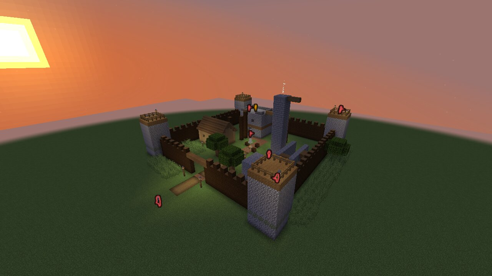

# L'Ombre — Infiltration (mod Minecraft)

Un mod **Fabric** pour **Minecraft Java 1.21.1** : jouer en assassin discret, avec du parkour et un fortin à infiltrer.

Fichier à installer : [`telecharger/ombre-infiltration-0.1.0.jar`](telecharger/ombre-infiltration-0.1.0.jar)

## Installation (une seule fois)

1. **Fabric** : télécharge l'installateur sur <https://fabricmc.net/use/installer/> (le `.exe` sous Windows) et lance-le.
   Onglet « Client », version Minecraft **1.21.1**, dernière version du Loader, puis « Installer ».
2. **Fabric API** : sur <https://modrinth.com/mod/fabric-api/versions>, filtre sur **1.21.1** et télécharge la version la plus récente (`fabric-api-0.116.…+1.21.1.jar`).
3. **Le dossier `mods`** : sous Windows, `Windows + R`, tape `%appdata%\.minecraft` puis Entrée. S'il n'y a pas de dossier `mods`, crée-le.
   Mets-y les **deux** fichiers `.jar` : Fabric API et `ombre-infiltration-0.1.0.jar`.
4. Ouvre le lanceur Minecraft, choisis le profil **fabric-loader-1.21.1**, puis « Jouer ».

### En bonus pour une grosse carte graphique : les shaders

Ajoute dans `mods` les mods **Sodium** (<https://modrinth.com/mod/sodium>) et **Iris** (<https://modrinth.com/mod/iris>), en version 1.21.1.
Mets ensuite un pack de shaders, par exemple *Complementary Reimagined* ou *BSL*, dans `.minecraft\shaderpacks`.
Dans le jeu : Options › Graphismes › Shader Packs. Une ville la nuit, avec les lanternes et les ombres, change tout pour un jeu d'infiltration.

## Premier essai

1. Crée un monde **Plat** (Plus d'options du monde › Type de monde : Plat), avec **« Autoriser les commandes : OUI »**.
   Difficulté **Normale** : en Paisible, les gardes disparaissent.
2. Dans le chat (touche `T`) :
   - `/give @s ombre:lame_de_nacre` puis `/give @s ombre:bombe_fumee 16`
   - `/ombre arene` : le fortin se construit à 30 blocs **devant toi**
   - `/time set night` pour l'ambiance
   - `/ombre aide` rappelle toutes les commandes
3. Ta cible, le **capitaine Morvan**, est sur le toit de la maison du nord. Avec l'Instinct (`V`), il brille en or et les gardes en rouge.

## Commandes

| Geste | Touches |
|---|---|
| **Escalader** un mur | Pousser contre le mur + garder **Espace**. **Maj** contre le mur = rester accroché |
| **Se rétablir** en haut | Automatique, en continuant d'appuyer sur Espace |
| **S'accrocher à un rebord** | Automatique en tombant le long d'un mur dont le haut arrive aux mains |
| Suspendu au rebord | **Espace** se hisser · **Q / D** se déplacer · **Maj** lâcher · **S + Espace** saut arrière |
| **Courir sur un mur** | En sprint, sauter le long d'un mur avec Z enfoncé (environ 1,5 s) |
| **Rebondir** d'un mur à l'autre | **Espace** pendant la course sur mur |
| **Bond** | Les sauts en sprint portent plus loin. En sprint, on monte aussi les marches d'un bloc sans sauter |
| **Saut de la foi** | Tomber dans une botte de **foin** ou du **feuillage** : aucun dégât |
| **Roulade** | Être accroupi (**Maj**) en touchant le sol : jusqu'à 9 blocs de chute sans mal |
| **Assassiner** | Frapper avec la **lame de nacre** une créature qui ne t'a pas repéré |
| **Assassinat aérien** | Frapper en tombant sur la créature (la chute est annulée) |
| **Double assassinat** | Une lame dans chaque main (`F` pour passer la 2ᵉ en main gauche) |
| **Se cacher** | Accroupi dans les hautes herbes, une fougère, un buisson, ou sous des feuilles |
| **Bombe de fumée** | Clic droit : les gardes autour perdent ta trace, aveuglés 5 s |
| **Instinct** | **V** : révèle les ennemis à travers les murs (toutes les 15 s) |
| **Siffler** | **B** : le garde le plus proche vient voir, sans donner l'alarme |
| **Point de vue** | Tenir debout au sommet de la grande tour (colonne de lumière) : tous les gardes sont révélés 30 s |

Les touches V et B se changent dans Options › Commandes › « L'Ombre — Infiltration ».

## Comment les gardes te voient

- De **dos** (hors de leur angle de vue de 140°), ils te repèrent de 3 fois moins loin.
- **Accroupi** : plus discret. **En sprint** : plus visible. **Dans le noir** : presque deux fois moins visible.
- Dans une **cachette** : on ne te voit qu'à 2 blocs.
- Un garde qui te repère **sonne l'alarme** (cloche) : les gardes à moins de 20 blocs accourent.
- Un garde qui t'a repéré n'est plus assassinable de face : il faut le perdre de vue, ou l'aveugler avec la fumée.

## Recettes

- **Lame de nacre** : lingot de fer (en haut à droite), coquille de nautile (au centre), cuir (en bas à gauche).
- **Bombe de fumée** (× 2) : poudre à canon + papier + charbon (sans ordre).

## Pour les curieux : compiler soi-même

Il faut Java 21. Dans ce dossier : `./gradlew build` (ou `gradlew.bat build` sous Windows). Le mod sort dans `build/libs/`.
`./gradlew runClient` lance directement Minecraft avec le mod.

| Fichier | Rôle |
|---|---|
| `Ombre.java` | Point d'entrée : branche chaque mécanique sur le jeu |
| `Assassinat.java` | Les assassinats à la lame |
| `Discretion.java` | À quelle distance un garde te voit (cachettes, dos, nuit…) |
| `mixin/LivingEntityMixin.java` | Modifie Minecraft : escalade et discrétion |
| `client/Parcours.java` | Le parkour : rebords, rétablissement, course sur mur, sauts |
| `Gardes.java` | Alarme, points de vue, course libre, contrat rempli |
| `Pouvoirs.java` | Instinct et sifflet |
| `BombeFumee.java`, `Chute.java` | Fumée ; saut de la foi et roulade |
| `Arene.java` | La carte : le fortin, son parcours et ses gardes |
