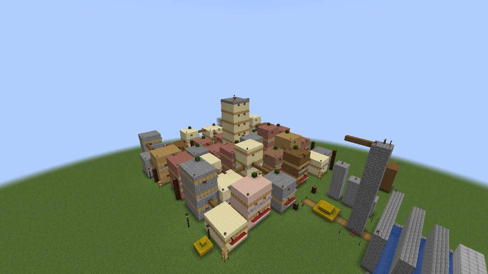
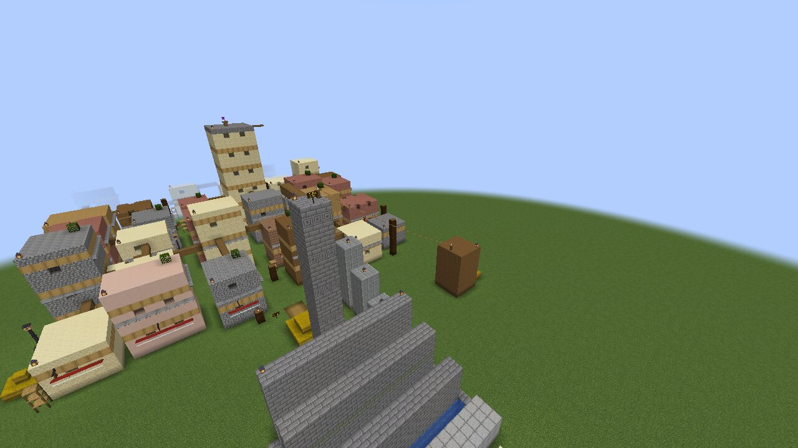
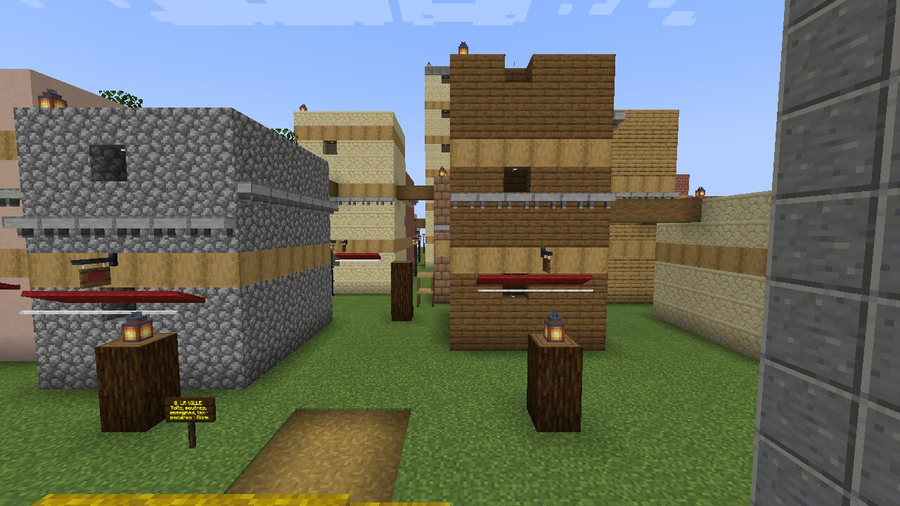

# L'Ombre — Infiltration (mod Minecraft)

Un mod **Fabric** pour **Minecraft Java 1.21.1** : jouer en assassin discret, avec du parkour et un fortin à infiltrer.

La carte d'entraînement (`/ombre parcours`) : la ville et ses toits, la tour avec sa tyrolienne, une rue avec corniches, enseignes et auvents.

Fichier à installer : [`telecharger/ombre-infiltration-0.1.0.jar`](telecharger/ombre-infiltration-0.1.0.jar)

## Installation (une seule fois)

1. **Fabric** : télécharge l'installateur sur <https://fabricmc.net/use/installer/> (le `.exe` sous Windows) et lance-le.
   Onglet « Client », version Minecraft **1.21.1**, dernière version du Loader, puis « Installer ».
2. **Fabric API** : sur <https://modrinth.com/mod/fabric-api/versions>, filtre sur **1.21.1** et télécharge la version la plus récente (`fabric-api-0.116.…+1.21.1.jar`).
3. **Le dossier `mods`** : sous Windows, `Windows + R`, tape `%appdata%\.minecraft` puis Entrée. S'il n'y a pas de dossier `mods`, crée-le.
   Mets-y les **deux** fichiers `.jar` : Fabric API et `ombre-infiltration-0.1.0.jar`.
4. Ouvre le lanceur Minecraft, choisis le profil **fabric-loader-1.21.1**, puis « Jouer ».

### En bonus pour une grosse carte graphique : les shaders

Ajoute dans `mods` les mods **Sodium** (<https://modrinth.com/mod/sodium>) et **Iris** (<https://modrinth.com/mod/iris>), en version 1.21.1.
Mets ensuite un pack de shaders, par exemple *Complementary Reimagined* ou *BSL*, dans `.minecraft\shaderpacks`.
Dans le jeu : Options › Graphismes › Shader Packs. Une ville la nuit, avec les lanternes et les ombres, change tout pour un jeu d'infiltration.

## Premier essai

1. Crée un monde **Plat** (Plus d'options du monde › Type de monde : Plat), avec **« Autoriser les commandes : OUI »**.
   Difficulté **Normale** : en Paisible, les gardes disparaissent.
2. Dans le chat (touche `T`) :
   - `/give @s ombre:lame_de_nacre` puis `/give @s ombre:bombe_fumee 16`
   - `/ombre arene` : le fortin se construit à 30 blocs **devant toi**
   - `/time set night` pour l'ambiance
   - `/ombre aide` rappelle toutes les commandes
3. Ta cible, le **capitaine Morvan**, est sur le toit de la maison du nord. Avec l'Instinct (`V`), il brille en or et les gardes en rouge.

## Commandes

**Touche H en jeu : un écran qui récapitule toutes les commandes.**

### Escalade (comme dans Assassin's Creed : on reste là où on est)

| Geste | Touches |
|---|---|
| S'accrocher à un mur | **Espace** en poussant vers le mur, ou sauter vers lui (on s'accroche au vol) |
| Monter / descendre | **Z / S** (en tenant Ctrl, plus vite) |
| Se déplacer sur le côté | **Q / D** |
| Bondir vers la prise du dessus | **Espace** |
| Bondir sur le côté | **Q ou D + Espace** |
| Saut arrière vers le mur d'en face | **S + Espace** (on se raccroche tout seul de l'autre côté) |
| Lâcher | **Maj** |
| En haut du mur | On se rétablit tout seul par-dessus le bord |

### Rebords, course et chutes

| Geste | Touches |
|---|---|
| **S'accrocher à un rebord** | Automatique en tombant le long d'un mur dont le haut passe aux mains |
| Suspendu | **Z ou Espace** se hisser · **Q / D** glisser · **Q ou D + Espace** sauter au rebord voisin · **S** redescendre sur le mur · **Maj** lâcher |
| **Courir sur un mur** | En sprint, sauter le long d'un mur avec Z enfoncé (environ 1,5 s) ; **Espace** rebondit vers le mur d'en face |
| **Bond** | Les sauts en sprint portent plus loin ; en sprint, les marches d'un bloc se montent seules |
| **Saut de la foi** | Tomber dans du **foin**, du **feuillage** ou sur un **auvent** : aucun dégât |
| **Roulade** | **Maj** en touchant le sol : jusqu'à 9 blocs de chute sans mal |

### Les objets de parkour (onglet « L'Ombre » du mode créatif)

| Objet | Comment s'en servir |
|---|---|
| **Poteau de tyrolienne** + **corde** | Corde en main, clic droit sur un poteau puis sur un autre (64 blocs max). Mains vides, clic droit sur le poteau le plus haut : on glisse. Espace saute (assassinat aérien possible), Maj lâche |
| **Monte-charge** | À poser au pied d'un mur en le regardant. Clic droit : on monte jusqu'au toit |
| **Perche** | Barre à saisir au vol : on se balance, **Z** donne de l'élan et projette, Espace saute, Maj lâche |
| **Enseigne de boutique** | Elle sort du mur : sa potence se saisit comme une perche |
| **Poutre** | Pièce de bois étroite pour relier deux toits |
| **Corniche** | Rebord de pierre à poser sur une façade : on s'y accroche, on le longe |
| **Auvent** | Toile sur une façade : on tombe dessus sans se faire mal |
| **Échafaudage** | Plateau sur poteaux, à empiler : des marches pour monter aux toits |
| **Lampadaire** + **tête de lampadaire** | Le fût s'escalade, le chapeau sert de perchoir. Il éclaire |
| **Perchoir** | Un point de vue à poser n'importe où : s'y tenir révèle les gardes 30 s |

Les poses du personnage (escalade, suspension, tyrolienne, perche, course sur mur…) se voient en vue extérieure : touche **F5**.

### Assassin

![Un sapeur vu de dos, entouré de rouge, et l'invite « [R] Assassinat »](apercu-assassinat.jpg)

Dès qu'un garde peut être tué, il est **entouré de rouge** et une invite s'affiche sous le viseur : **« [R] Assassinat »**. Appuie sur **R**. Il suffit d'avoir la lame de nacre dans l'inventaire.

| Assassinat | Quand le contour rouge apparaît |
|---|---|
| **Au sol** | Le garde ne t'a pas repéré, il est devant toi, à 3 blocs |
| **Aérien** | Le garde est sous toi (depuis un toit, un rebord ou en tombant) : tu plonges sur lui, **même s'il t'a vu** |
| **Depuis un rebord** | Tu es suspendu, et un garde marche au bord du toit juste au-dessus |
| **Double** | Une lame dans chaque main (`F` pour en passer une en main gauche) : un 2ᵉ garde distrait tout près tombe aussi |
| **Clic gauche** | Marche toujours : frapper un garde distrait avec la lame le tue d'un coup |

Un garde qui t'a repéré n'a plus de contour rouge (sauf pour l'assassinat aérien) : sème-le, ou aveugle-le avec une bombe de fumée.

| Geste | Touches |
|---|---|
| **Se cacher** | Accroupi dans les hautes herbes, une fougère, un buisson, ou sous des feuilles |
| **Bombe de fumée** | Clic droit : les gardes autour perdent ta trace, aveuglés 5 s |
| **Instinct** | **V** : révèle les ennemis à travers les murs (toutes les 15 s) |
| **Siffler** | **B** : le garde le plus proche vient voir, sans donner l'alarme |
| **Point de vue** | Tenir debout au sommet de la grande tour (colonne de lumière) ou sur un perchoir |

Les touches R, V, B et H se changent dans Options › Commandes › « L'Ombre — Infiltration ».

### Commandes du chat

| Commande | Effet |
|---|---|
| `/ombre parcours` | Grande carte d'entraînement, **sans gardes**, et on y est emmené : escalade, course libre, bonds, course sur mur, rebond, rebords, saut de la foi, roulade, monte-charge, tyrolienne, perches, et une ville de 36 maisons avec tout le mobilier |
| `/ombre arene` | Le fortin à infiltrer (9 gardes, une cible), avec une tyrolienne et un monte-charge |
| `/ombre aide` | Le rappel des commandes dans le chat |

## Comment les gardes te voient

- De **dos** (hors de leur angle de vue de 140°), ils te repèrent de 3 fois moins loin.
- **Accroupi** : plus discret. **En sprint** : plus visible. **Dans le noir** : presque deux fois moins visible.
- Dans une **cachette** : on ne te voit qu'à 2 blocs.
- Un garde qui te repère **sonne l'alarme** (cloche) : les gardes à moins de 20 blocs accourent.
- Un garde qui t'a repéré n'est plus assassinable de face : il faut le perdre de vue, ou l'aveugler avec la fumée.

## Recettes

- **Lame de nacre** : lingot de fer (en haut à droite), coquille de nautile (au centre), cuir (en bas à gauche).
- **Bombe de fumée** (× 2) : poudre à canon + papier + charbon (sans ordre).
- **Poteau de tyrolienne** (× 2) : crochet, bâton, bâton (en colonne). **Corde** (× 4) : laisse + 2 ficelles.
- **Monte-charge** : rondins sur les côtés, crochet en haut au milieu, planches en bas.
- **Perche** (× 4) : bâton, lingot de fer, bâton (en ligne). **Poutre** (× 6) : 3 rondins de sapin écorcés en ligne.
- **Corniche** (× 6) : 3 pierres lisses, une brique de pierre dessous. **Auvent** (× 4) : 3 laines, 2 bâtons dessous.
- **Échafaudage** (× 4) : 3 planches, 4 bâtons en dessous. **Lampadaire** (× 3) : 3 pierres noires polies en colonne.
- **Tête de lampadaire** : pierre noire, pierre lumineuse, pierre noire (en colonne). **Enseigne** (× 2) : 3 lingots de fer en équerre + une planche.
- **Perchoir** : une plume au-dessus d'un rondin.

## Pour les curieux : compiler soi-même

Il faut Java 21. Dans ce dossier : `./gradlew build` (ou `gradlew.bat build` sous Windows). Le mod sort dans `build/libs/`.
`./gradlew runClient` lance directement Minecraft avec le mod.

| Fichier | Rôle |
|---|---|
| `Ombre.java` | Point d'entrée : branche chaque mécanique sur le jeu |
| `Assassinat.java` | Les assassinats à la lame |
| `Discretion.java` | À quelle distance un garde te voit (cachettes, dos, nuit…) |
| `mixin/LivingEntityMixin.java` | Modifie Minecraft : escalade et discrétion |
| `client/Parcours.java` | Le parkour : escalade libre, rebords, rétablissement, course sur mur, tyrolienne, monte-charge, perche |
| `client/Animations.java` | Les poses du personnage pendant le parkour |
| `client/EcranAide.java` | L'écran d'aide (touche H) |
| `client/RenduCordes.java` | Le dessin des cordes de tyrolienne et de monte-charge |
| `bloc/` | Les blocs de parkour (tyrolienne, monte-charge, perche, perchoir, mobilier) |
| `CarteParcours.java` | La grande carte d'entraînement (`/ombre parcours`) |
| `Gardes.java` | Alarme, points de vue, course libre, contrat rempli |
| `Pouvoirs.java` | Instinct et sifflet |
| `BombeFumee.java`, `Chute.java` | Fumée ; saut de la foi et roulade |
| `Arene.java` | La carte : le fortin, son parcours et ses gardes |
